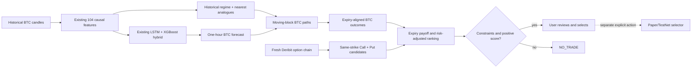

# BTC Dynamic Short Straddle — Enhancement Audit and Delivery Status

**Audit date:** 2026-11-16  
**Scope:** Existing BTC candles/features, hybrid model and artifacts, live Deribit option analysis, strategy/risk code, Streamlit research view, backtesting, configuration, tests, and execution controls.

## Repository baseline

- No `AGENTS.md` files were found in the project inventory.
- The checkout has no commits and the project files appear untracked in Git, so there is no committed baseline diff to compare against.
- A local `.env` exists and was not opened or copied.
- Before implementation, the full existing suite passed: **34 passed**.
- The promoted 104-feature hybrid artifact set and prior experiment artifacts were retained. Walk-forward experiments were written outside `data/processed/model_artifacts/`.

## KEEP / MODIFY / CREATE audit

| Area | Decision | Audit finding and delivery |
|---|---|---|
| `data/feature_engineering.py`, `models/dataset.py` | KEEP / extend tests | Existing causal multi-timeframe alignment, 104 numeric features, one-hour target, exact-horizon check, 12-row purge, chronological splits, and train-only scaling are present. No feature definitions or target were silently replaced. |
| `models/train.py`, promoted model artifacts | KEEP | Retained the existing LSTM + four XGBoost estimator architecture, validation-derived artifact blend, and saved promoted weights. No retraining wrote into the promoted artifact directory. |
| `models/hybrid_inference.py`, `models/lstm_inference.py`, `models/interfaces.py` | MODIFY | Prediction metadata now reports reference candle price, model availability, and input validation state. Confidence remains unset. The blend continues to load weights from `training_report.json`. |
| `models/market_regime_detector.py` | CREATE | Causal regime categories, robust-scaled nearest historical analogues, similarity scores, matured one-hour outcome summaries, matched-volatility summary, and insufficient-sample warnings. |
| `models/historical_scenario_generator.py` | CREATE | Reproducible contiguous moving-block paths, regime-conditioned historical start points, model-conditioned first hour, exact expiry alignment, terminal price quantiles, input validation, and a path-size limit. The model’s expected return is used to condition the first-hour distribution rather than being repeatedly added to historical returns. |
| `strategies/dynamic_straddle.py`, `config/risk_config.py` | MODIFY | Optional expiry-scenario payoff ranking, expected profit probability, moneyness, candidate explanations, positive expected-P&L/score floor, required displayed bid size, and explicit `SELECT_PAIR` / `NO_TRADE` state. Same-strike/same-expiry matching remains enforced. |
| `options/contracts.py`, `options/option_validation.py`, `options/combined_straddle_analyzer.py`, `options/option_chain_loader.py`, `data/deribit_live.py`, `strategies/atm_selection.py` | MODIFY | Carry verified settlement currency and exchange mark price, reject unknown/non-BTC-settled inputs for the BTC payoff model, aggregate combined Greeks/credits with multipliers and quantity, and compute an explicitly labeled Deribit standard inverse-margin estimate only when mark prices are available. |
| `streamlit_app.py` | MODIFY | AI research refreshes Binance candles/model output and Deribit public chain every minute while open, identifies closed-candle patterns across four timeframes, vetoes high candle-risk conditions, restricts selection to a configurable near-ATM band, compares risk-adjusted expiry scenarios, and requires separate user action to transfer a pair. It submits no order. |
| `options/historical_options_loader.py` | CREATE | Loads the available Deribit trade/mark tape and labels the evidence correctly. It never fabricates bid/ask, size, or fills. |
| `backtesting/straddle_backtester.py` | CREATE | Adds ATM and existing dynamic mark-proxy summary metrics. Historical-scenario selector variants remain explicitly `not_evaluated` without causal selector rows and overlapping option data. |
| `backtesting/walk_forward.py`, `scripts/evaluate_walk_forward.py` | CREATE | Builds purged expanding chronological folds; can train the existing architecture into isolated fold artifact directories or evaluate supplied out-of-fold predictions. |
| `scripts/evaluate_model_reliability.py` | MODIFY | Adds per-class precision/recall/F1, multiclass Brier, calibration bins/ECE, extreme precision/recall/Brier/calibration, regime-grouped results when features are available, and the existing zero-return/majority baselines. |
| `scripts/generate_historical_scenarios.py` | CREATE | Reproducible CLI scenario report from the saved held-out forecast and historical BTC candles. |
| `scripts/train_models.py` | MODIFY | Default output is a timestamped experiment directory. Writing into the promoted artifact directory now requires an explicit `--promote-artifacts` flag. |
| Tests and `README.md` | MODIFY / extend | Added coverage for regime causality, scenario seeds/expiry/memory limit, fold purges, option tape classification, settlement, multiplier economics, NO_TRADE, and reliability metrics. README includes commands and an updated Mermaid architecture diagram. |

## Data evidence and current limitations

### BTC and options sources

- Prepared multi-timeframe BTC feature history: 407,397 rows / 116 table columns / 104 model inputs.
- Historical Deribit options archive: 859,140 actual trade rows from **2025-01-01 through 2025-02-28**, including trade price, mark price, IV, index price, amount, and instrument identifiers.
- The archive has no historical bid/ask quote, displayed order-book size, queue position, or strategy fill confirmation. Its prices can support a labeled mark-price proxy only.
- The current promoted model’s held-out period is April–November 2026, with no overlap with the options tape.
- The public option-chain summary provides exchange `mark_price`; when present, the research ranker computes the documented standard BTC inverse-option initial and maintenance margin estimates per leg. It does not substitute bid/ask midpoint for mark price. See [Deribit inverse-option specifications](https://support.deribit.com/hc/en-us/articles/31424939096093-Inverse-Options). These estimates assume the standard margin formulas and are not authenticated account results; account mode, portfolio offsets, and equity are unavailable, so account-specific margin fractions and return on margin remain unavailable.
- TestNet credentials/scopes were not verified in this implementation turn. No order was submitted and live execution was not enabled.

### Model reliability

The promoted model’s 5,089 hourly-spaced held-out predictions (2026-04-17 to 2026-11-15) were re-evaluated in `data/reports/model_reliability_enhanced.json`:

- Hybrid return MAE: **0.26446%** versus zero-return baseline **0.26397%**.
- Hybrid return RMSE: **0.40487%** versus zero-return baseline **0.40421%**.
- Direction accuracy: **63.76%** versus majority baseline **63.61%**. At argmax, bearish and bullish recall are low; most predictions are sideways.
- Extreme precision and recall at a 0.5 probability threshold are both **0%**; extreme accuracy is not a useful standalone metric for the rare event.
- q10–q90 interval coverage: **86.56%** on this test period.

Three expanding-window folds were trained using the retained LSTM + XGBoost architecture, each in an isolated experiment directory. The new aggregate report is `data/reports/walk_forward_runs/20261116T033548Z/walk_forward_reliability.json` with 2,160 one-hour-spaced out-of-fold predictions from **2026-07-20 through 2026-10-18**:

- Aggregate return MAE **0.23438%** versus zero-return baseline **0.23391%**; RMSE **0.36643%** versus **0.36606%**.
- Direction accuracy **68.70%** versus majority baseline **68.61%**. Bearish and bullish recall are **3.43%** and **4.76%**, respectively; the model still mostly predicts sideways.
- Extreme precision/recall at the 0.5 threshold remain **0%**. Extreme Brier score is 0.02079 versus prevalence baseline 0.02217; q10–q90 interval coverage is **83.66%**.
- Per-fold return MAE versus zero baseline: fold 29 **0.17967% / 0.17953%**, fold 30 **0.28868% / 0.28763%**, fold 31 **0.23481% / 0.23458%**. The walk-forward return forecast does not beat the zero-return baseline on any fold.
- These folds address the prior incomplete-run gap, but three adjacent folds do not constitute broad-market or profitability validation. The report also records that this evaluator cannot independently prove every preprocessing fit boundary from predictions alone, although the training script creates isolated per-fold models and artifacts.

### Mark-price proxy replay

The 2025 test rows from the older pre-expansion hybrid model overlap the available trade tape. A separate proxy run used configured **0.1% fee and 0.1% slippage sensitivity rates**; those rates are assumptions, not verified Deribit costs. Results are in `data/reports/mark_proxy_backtest_runs/20261115T190219Z/heldout_mark_proxy_report.json`:

- 1,334 candidate decisions; only 176 ATM and 159 dynamic decisions had fresh two-leg exit marks (13.2% and 11.9% coverage).
- ATM average mark-proxy P&L: **−0.001243 BTC** per normalized unit; win rate 48.9%.
- Existing dynamic average mark-proxy P&L: **−0.000973 BTC** per normalized unit; win rate 56.6%.
- Both means are negative. These are older-model mark-price proxy observations, not verified fills, and overlapping snapshots do not produce a valid account equity curve. Max drawdown, Sharpe, Sortino, and return on margin are intentionally null.
- The current promoted 2026 forecast replay selected zero pairs because the option tape ended in February 2025. Historical-scenario and hybrid-plus-scenario backtest variants are reported as not evaluated.

### Scenario example

`data/reports/historical_scenario_runs/` contains a 500-path, seed-42 simulation from the saved prediction at **2026-11-15 13:49:59 UTC** to **2026-11-20 08:00 UTC**. The BTC reference candle was $65,528.01; the simulated expiry median was $65,816.59, with 5th/95th percentiles $60,566.25/$71,468.97. These numbers are simulated scenario outcomes, not observed prices or profits.

## Verification

- Baseline suite before changes: **34 passed**.
- Final suite after changes: **52 passed**.
- `compileall` succeeded for `models`, `options`, `backtesting`, `scripts`, and `streamlit_app.py` after the live-candle freshness guard was added.
- Promoted `data/processed/model_artifacts/` was not written by the walk-forward experiment. The report and replay outputs use new paths.

## Remaining work/data required

1. Obtain historical Deribit BBO/order-book depth covering the same periods as strictly out-of-fold forecasts to compare ATM, current dynamic ranking, historical-scenario dynamic selection, and hybrid-plus-scenario selection using executable-price assumptions.
2. Verify account mode and use authenticated Deribit margin/account APIs before presenting any account-specific margin fraction or return-on-margin figure. The current figure is only a standard-model estimate based on exchange mark prices.
3. Complete a real, authorized TestNet end-to-end order lifecycle test—including both legs, partial fills, failed second leg, reconciliation, and no-live-order safeguards—before describing execution as verified.

## Follow-up blueprint implementation

- Added `models/expiry_forecaster.py` as a validation wrapper that requires at least 1,000 paths and checks exact expiry alignment. Scenario sets now report terminal mean/median, specified-level path-touch probabilities, and path-based extreme-move probability. The live research control defaults to 1,000 paths and does not select without a valid expiry-matched scenario set or available hybrid prediction.
- Added quantity-aware displayed bid-size rejection, an explicit maximum simulated-loss gate, absolute standard-margin gate, and configurable CVaR confidence in the ranker. These are selection estimates, not execution guarantees.
- The live research path now rejects a prediction whose latest completed 5m candle is more than 10 minutes old. It rechecks after the 60-second Streamlit cache so a cached prediction cannot continue to appear current. The standalone prediction CLI remains an offline prepared-data command.
- Added descriptive candle-pattern detection for doji, hammer/shooting-star, engulfing, inside bars, breakouts, volume spikes, and range expansion. A configurable risk-score veto sends the ranker to `NO_TRADE`; the default strike search band is ±2% around the BTC index. This is a conservative risk rule, not a proven pattern-based trading edge.
- The Streamlit runtime's unit suite passed (54 tests) and `compileall` passed. A full in-process AppTest smoke run did not finish within the allotted wait and was stopped; the refresh fragment therefore still needs an end-to-end app-session check with the live feeds available.
- In this verification environment, a direct Binance candle refresh failed DNS resolution for both configured public API hosts. Therefore no current live candle or live application prediction was verified in this run; the UI reports the fetch error rather than falling back to stale prepared candles.
- Added JSON-compatible YAML files in `configs/`, loaded by `config/strategy_settings.py`, plus reusable verified-ledger strategy comparison and performance-metric modules under `backtesting/`.
- The strategy comparison remains **not evaluated**: the available Deribit archive is trade/mark tape, not historical BBO/order book, and there are no four matching out-of-fold realized-fill ledgers. The completed three-fold forecast study does not resolve the missing option quotes or TestNet lifecycle verification.
- The first post-change `tests/` collection exposed a removed `_weighted_cvar95` import still used by the mark-proxy replay; a compatibility wrapper was restored. Verification then passed: **34 tests in `tests/` and 18 in `config/tests/` (52 total)**. The three-fold walk-forward run and aggregate report also completed. `compileall` and config loading passed.

## Architecture

