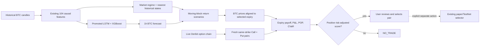

# BTC Options Short-Straddle Demo

This project contains a deterministic BTC ATM short-straddle demo, a Streamlit dashboard for public Deribit production data, and an explicit NautilusTrader strategy for Deribit TestNet. Production market data remains read-only. TestNet order submission is disabled by default and the automated client is fixed to the TestNet environment.

The target environment is 64-bit CPython 3.12.10 with NautilusTrader 1.231.0.

## Setup

From PowerShell at the project root:

```powershell
py -3.12 -m venv .venv
.\.venv\Scripts\Activate.ps1
python -m pip install --upgrade pip
python -m pip install -r requirements.txt
Copy-Item .env.example .env
python -c "import nautilus_trader; import nautilus_trader.adapters.deribit; print('NautilusTrader', nautilus_trader.__version__); print('Deribit adapter import: OK')"
```

The demo, public production market data, and paper simulator run without exchange credentials. Copy `.env.example` to `.env` and add a Deribit **TestNet** API key to `DERIBIT_TESTNET_CLIENT_ID` and `DERIBIT_TESTNET_CLIENT_SECRET` to use the account panel. Create a separate TestNet key with `account:read` and `trade:read_write` scopes. The key is passed to the local NautilusTrader worker process only when you explicitly connect; credentials and OAuth tokens are not written to the strategy state files.

`DERIBIT_TESTNET_ORDER_SUBMISSION_ENABLED` defaults to `false`. Set it to `true` only when you intend to enable TestNet orders, then restart Streamlit. `DERIBIT_TESTNET=true` is required; the authenticated client has a fixed `https://test.deribit.com/api/v2` endpoint. Production order submission is not implemented. `LIVE_TRADING_ENABLED` remains false for the deterministic demo runtime; it does not enable production execution.

## Open the demo GUI

After installing the dependencies and activating `.venv`, run:

```powershell
python -m streamlit run streamlit_app.py
```

Streamlit opens the dashboard in your browser. **Demo** shows the sample Call/Put, synthetic fills, entry premium, and risk thresholds. Choose **Live Deribit** for production public market data and paper-only controls. Choose **Deribit TestNet** to load TestNet-specific instruments and quotes; neither the account nor the strategy connects automatically.

In TestNet mode, click **Connect TestNet account** to authenticate and read the BTC account summary. After enabling the server opt-in, click **Start NautilusTrader TestNet strategy**. The node starts in a separate local worker process, loads only the selected Call and Put, subscribes to both quote streams, and performs startup reconciliation. It waits for the initial exchange sync before reporting **ready**; it then checks open-order status every 10 seconds and positions every 30 seconds. Only after the strategy reports **ready** can you submit a pair of GTC post-only limit sells through NautilusTrader. The entry checkbox confirms that either leg can fill independently.

The strategy consumes NautilusTrader order acceptance, fill, rejection, cancellation, and position events. It waits up to 12 seconds for the entry legs to match, cancels remaining entry orders on timeout or rejection, and submits reduce-only market buys for unmatched exposure after cancellation is confirmed. For a matched open straddle it evaluates the combined Call + Put ask against a 1% stop-loss and 2% take-profit, then submits reduce-only market buys for both open legs. Rejected close orders receive up to three retries; repeated failures, unknown orders, or account positions that do not match the saved cycle pause automation and show a manual-review state. The selected pair’s open orders can still be refreshed or canceled from the account panel.

Strategy state and order-role mappings are stored locally under `.runtime/deribit/` so the node can compare saved fills with the account after a restart. On startup or reconnect, it waits for exchange reconciliation, then matches the selected pair's open orders and short positions to the saved cycle. Known in-flight entry orders are canceled and recovered; known close orders are monitored without submitting duplicates. Unknown orders, unexpected position changes, or a mismatch between saved fills and the account block automation for manual review. These controls use synthetic-fund TestNet only; they are not a production execution guarantee.

In the paper-trade simulator, an entry is capped at the displayed bid size on both legs; a close uses the displayed ask size. It reports the existing 1% stop-loss and 2% take-profit rules as signals and only simulates a close when you click the button. The last 300 fresh quote samples are kept in the browser session and can be replayed or downloaded as CSV. The in-app AI chat streams open-ended answers from a local Ollama model using the latest dashboard snapshot. Start the Ollama desktop app, install a chat model, and choose **Refresh local models** in the chat panel. Conversation prompts and live market context are sent only to Ollama on `127.0.0.1:11434`, not to an external AI provider. Paper positions, chat, and quote history are local to the current session.

## Current behavior

`main.py` loads settings and calls `StrategyRuntime.run()`. The runtime then:

1. Creates a sample BTC option catalog around a fixed BTC reference price.
2. Filters the sample instruments and selects a matching ATM Call and Put.
3. Builds one SELL order request for each leg.
4. Applies synthetic fill events to the order-state machine.
5. Calculates the combined entry premium and the 1% stop-loss / 2% take-profit thresholds.

The output is a demo plan, not evidence of an exchange connection or trade. The TestNet service is a separate user-started runtime; the demo path never starts the node or sends exchange orders.

## Project layout

- `config/`: environment settings, logging, and Deribit TestNet config builders
- `data/`: option metadata normalization, quote validation, Deribit REST catalog retrieval, and a public WebSocket feed
- `execution/`: order request/fill primitives, paper simulation, TestNet account operations, and the NautilusTrader strategy worker
- `strategies/`: ATM pair selection, short-straddle validation, and risk-threshold helpers
- `runtime.py`: demo orchestration and the selected-pair TestNet strategy startup API
- `execution/deribit_nautilus.py`: background node service, order/fill event handling, risk exits, and unmatched-leg recovery
- `execution/deribit_nautilus_worker.py`: isolated worker-process entry point for the TestNet node
- `data/deribit_live.py`: read-only requests to Deribit's public production API
- `data/deribit_stream.py`: reconnecting public WebSocket ticker and index feed
- `execution/paper_trader.py`: top-of-book paper entry/exit calculations
- `execution/deribit_testnet.py`: fixed-TestNet OAuth, account summary, open-order lookup, and cancellation
- `chat/ollama_client.py`: local-only Ollama model discovery and streaming chat
- `streamlit_app.py`: browser-based demo, live chain, paper simulator, and quote replay dashboard
- `config/tests/`: focused tests for helpers and demo orchestration
- `resouces/`: assignment report and implementation notes

## Execution limits

The two TestNet entry legs are separate exchange orders and cannot be atomic. Entry orders are post-only; risk and recovery exits use market orders and can incur slippage. If the node cannot confirm cancellation, reconcile an open order, match a saved position, or complete repeated close attempts, it halts automated actions and requires account review. The paper simulator remains research-only and does not guarantee fills; it uses displayed top-of-book depth and metadata-validated BTC inverse accounting.

## Data and model research workflow

### Project status

- **Data and ML forecasting — implemented:** candle ingestion/preprocessing, multi-timeframe features, LSTM, XGBoost, and hybrid inference are in place. The current candidate was trained on Binance candle history from 2023-01-01 through 2026-11-15.
- **Model reliability — still unproven:** the promoted-model holdout covers 2026-04-17 through 2026-11-15 (5,089 rows). Return MAE is 0.2645% versus 0.2640% for the zero-return baseline; direction accuracy is 63.8% versus a 63.6% majority baseline. A separate three-fold expanding walk-forward run now covers 2,160 rows from 2026-07-20 through 2026-10-18. Its aggregate MAE is 0.23438% versus 0.23391% for zero return, and direction accuracy is 68.70% versus a 68.61% majority baseline. Directional recall and extreme-move detection remain weak; these small differences do not establish trading value. See `data/reports/walk_forward_runs/20261116T033548Z/walk_forward_reliability.json`.
- **Dynamic option selection — integrated as research and user-selected pair input:** the AI research tab ranks live same-strike pairs by expected net P&L minus a configurable CVaR95 penalty. Clicking the candidate action updates the main pair selector used by quotes, the paper panel, and the TestNet form. TestNet submission remains a separate, explicitly confirmed action; ranking never submits an order automatically.
- **Strategy backtesting — proxy only:** `scripts.backtest_mark_proxy` replays point-in-time Deribit marks, with configurable costs, but no historical bid/ask/order-book data is available. The option tape covers Jan–Feb 2025 while the current model's test period is Apr–Nov 2026, so the saved 2025 replay does not validate the current model/strategy combination and is not a complete executable-fill backtest.
- **TestNet execution — framework implemented, end-to-end verification pending:** the app supports explicit TestNet authentication, a user-selected pair, managed separate-leg entries, recovery, and risk exits. Order submission is disabled by default and requires an explicit server-side opt-in. The configured API key did not grant the required `account:read` and `trade:read_write` scopes during the latest connection check, so no order/fill/close verification was possible. The complete lifecycle remains unverified.

Raw downloads belong in `data/raw/`; the inspection and preprocessing commands discover CSV files (and CSV members inside ZIP archives) beneath that directory. The pipeline normalizes candle timestamps to UTC, preserves useful source columns, reports duplicate timestamps and missing candle intervals, and exports `btc_5m.parquet`, `btc_15m.parquet`, `btc_1h.parquet`, and `btc_daily.parquet` under `data/processed/`. JSON and CSV diagnostics are written under `data/reports/`. Source files are read-only to the pipeline. Overlapping BTCUSDT candles are deduplicated by source priority: directly fetched Binance candles, Binance Kline dumps, then other exports; Bitstamp BTC/USD is reported but excluded from the BTC/USDT series.

To add a longer BTCUSDT history from Binance's public API, download an inclusive UTC date range and then rerun inspection and preprocessing:

```powershell
python -m scripts.download_binance_history --start 2023-01-01 --end 2026-11-15
python -m scripts.inspect_datasets
python -m scripts.preprocess_datasets
python -m scripts.build_features
python -m scripts.prepare_training_data
python -m scripts.train_models
python -m scripts.evaluate_model_reliability
```

The downloader stores source CSVs under `data/raw/binance_history/`; it does not replace or delete existing raw data. Review the quality reports for gaps and overlaps before retraining.

```powershell
python -m scripts.inspect_datasets
python -m scripts.preprocess_datasets
pytest tests/ -v
```

The `options/` package normalizes public Deribit instruments and quotes, checks quote freshness, matches same-strike/same-expiry Call–Put pairs, and analyzes the combined short straddle. The `models/` package trains and serves an offline hybrid LSTM + XGBoost research forecast. The dashboard's **AI research** tab ranks fresh live same-strike pairs; its **Use this pair in the main selector** action sets the pair used by the quote, paper, and TestNet panels. BTC chat receives the forecast, ranked candidates, and recent live candle context. The model never submits orders; TestNet entry still requires a separate explicit confirmation.

Generate multi-timeframe candle features after preprocessing:

```powershell
python -m scripts.build_features
```

This creates `data/processed/btc_multitimeframe_features.parquet` with candle returns and momentum, rolling volatility, candle shape, volume and trade-flow measures, and UTC calendar cycles. Higher-timeframe values are joined only from candles closed by each 5-minute decision time; stale values and missing intervals are not fabricated.

### Model training preparation

Prepare labels and chronological train/validation/test splits, then train the hybrid model:

```powershell
python -m scripts.prepare_training_data
python -m pip install -r requirements-ml.txt
python -m scripts.train_models
```

The target horizon is one hour. Scalers fit training rows only, with a 12-row purge between chronological splits. `--sequence-stride 12` trains and evaluates the multitask models on one hourly decision per twelve 5-minute rows, reducing repeated overlapping targets. Training now writes to a timestamped `data/processed/model_artifacts_experiments/` directory by default so a research run cannot replace promoted artifacts. To explicitly promote into `data/processed/model_artifacts/`, pass that `--output-dir` and `--promote-artifacts`. `requirements-ml.txt` pins the verified CPU PyTorch, scikit-learn, XGBoost, NumPy, pandas, and PyArrow versions for the activated project `.venv`; no Anaconda `PYTHONPATH` bridge is needed. Run `python -m scripts.predict_hybrid` for a prepared-data forecast, or `python -m scripts.evaluate_model_reliability` for return baselines, classification precision/recall/F1, Brier scores, calibration, quantile coverage, and regime-grouped diagnostics when matching feature data is available. The current 5,089-row test set spans 2026-04-17 to 2026-11-15. Return MAE is 0.2645% versus 0.2640% for zero return; direction accuracy is 63.8% versus the 63.6% majority baseline; extreme-move accuracy matches its 97.1% baseline, while extreme log loss improves from 0.1373 to 0.1108. The 10th–90th interval covered 86.6% of outcomes. These results still do not establish a profitable trading signal; use true walk-forward forecasts before any trading use.

### Dynamic straddle research

In **Live Deribit → AI research**, the application refreshes the live Binance candle/model snapshot and public Deribit option-chain summary every 60 seconds while the tab is open. It identifies completed-candle patterns across 5m, 15m, 1h, and daily bars, including doji, hammer/shooting-star, engulfing, inside bars, range breakouts, volume spikes, and range expansion. A configurable candle-risk veto forces `NO_TRADE` when breakout/expansion context is elevated; the patterns are descriptive risk context, not calibrated forecasts. The search is limited to a configurable ±2% near-ATM band by default, then ranks same-strike, same-expiry Call–Put pairs by expiry-scenario net P&L and CVaR. For a selected candidate, the panel reports scenario probability of loss, CVaR95 loss, worst sampled loss, and a standard margin estimate when available; it also labels a transparent heuristic risk band. The risk band is not a calibrated safety rating, and the worst sampled loss is not the maximum possible loss. Clicking **Use this pair in the main selector** applies that model recommendation to the quote, paper, and TestNet panels and carries its risk estimates into the main dashboard. A later recommendation refresh does not silently replace the active pair; apply a new candidate explicitly. This action never submits an order. The latest completed 5m candle must be no more than 10 minutes old; stale or unavailable inputs make the AI research view fail closed instead of presenting yesterday's prepared-file forecast as current. The offline command `python -m scripts.predict_hybrid` can score historical prepared files and should not be confused with live freshness. At least 1,000 scenarios are required. The expiry forecaster reports mean/median, quantiles, path-touch probabilities at selected BTC levels, and extreme-move probability. The selector requires an available hybrid model and scenarios matching the actual option expiry; it returns `NO_TRADE` if any required condition fails. It also checks expected net P&L, probability of profit, CVaR, spread, displayed bid size, maximum simulated loss, and standard margin when mark prices are available. Candle patterns and simulated outcomes cannot guarantee a profitable strike. Current option bids and exchange mark prices are observed quotes; future BTC paths are simulations. Standard margin is not an authenticated account or portfolio-margin result. Historical fills remain unavailable. Paper simulation remains manual, and TestNet submission remains separately confirmed.

The market-regime detector is in `models/market_regime_detector.py`; expiry-aligned moving-block scenarios and their validation wrapper are in `models/historical_scenario_generator.py` and `models/expiry_forecaster.py`. Scenario, optimizer, and backtest settings live in the JSON-compatible YAML files under `configs/` and load through `config/strategy_settings.py`. `options/historical_options_loader.py` labels the saved Deribit tape as trade/mark proxy data and does not create bid/ask quotes. `backtesting/walk_forward.py` provides purged expanding-window fold construction; `backtesting/strategy_comparison.py` and `backtesting/performance_metrics.py` accept verified, non-overlapping trade ledgers only. A credible quote-based strategy backtest still requires historical Deribit order-book quotes and enough overlap with predictions produced without future training data.

### Paper position accounting

The Live Deribit and TestNet paper panel now records Call and Put fills separately, matches both legs to the smaller displayed size, validates bid/ask, timestamp, expiry, currencies and contract multiplier, and blocks accounting if the instrument metadata is unsupported. For the current inverse BTC options, amount is already expressed in BTC underlying units and the Deribit multiplier is validated as 1 BTC; do not multiply the amount by that multiplier a second time. BTC P&L is `(entry premium BTC/BTC - executable close premium BTC/BTC) × filled amount BTC`, calculated per leg and then summed. Fees are an estimate using the configured Deribit Standard-tier options reference (3 bps of BTC amount, capped at 12.5% of premium); the actual account tier, fee discounts, and exact maker/taker outcome can differ. Additional slippage defaults to zero because bid/ask crossing is already reflected in the executable P&L; configure extra slippage only when you have an explicit assumption. Stop-loss and take-profit signals compare net unrealized P&L with configured percentages of the remaining entry credit and never close automatically. Close requires a review and a separate confirmation; insufficient Ask Size produces a matched partial close and leaves both remaining legs open.

Paper settings are in `configs/paper_trading.yaml`. The active position and append-only lifecycle events are persisted in `.runtime/paper_trading.sqlite3`; restarting Streamlit restores the open position and prior event history. Stale, crossed, incomplete, expired, or unsupported-currency quotes prevent normal valuation/entry/close. Expired positions are marked `EXPIRED_AWAITING_SETTLEMENT`; settlement data is not yet fetched, so the app does not fabricate an expiry price or call an expired position closed. Historical legacy positions without stored per-leg prices are preserved as unverified and cannot be valued or closed by the new calculator.

Run a reproducible expiry scenario report from the latest saved held-out forecast (scenario output is simulated, not a trading result):

```powershell
python -m scripts.generate_historical_scenarios --expiry 2026-11-27T08:00:00Z --simulations 1000 --block-length 12 --seed 42
```

Run the historical options mark-price proxy comparison. The report keeps ATM and existing dynamic proxy metrics separate and labels the historical-scenario comparisons unavailable when no causal decision rows are supplied:

```powershell
python -m scripts.backtest_mark_proxy --fee-rate 0.001 --slippage-rate 0.001
```

Train the existing hybrid architecture on the latest three expanding historical folds, with each fold's artifacts isolated from promoted models, then create an out-of-fold reliability report:

```powershell
python -m scripts.evaluate_walk_forward --features data/processed/btc_multitimeframe_features.parquet --max-folds 3
```

To evaluate an externally generated walk-forward prediction file instead:

```powershell
python -m scripts.evaluate_walk_forward --predictions path\to\walk_forward_predictions.parquet --features data/processed/btc_multitimeframe_features.parquet
```

The walk-forward runner retrains the existing LSTM and XGBoost architectures inside each chronological fold; it does not change the promoted weights. Training cutoff timestamps are included for audit. It still cannot turn the January–February 2025 trade tape into executable fill evidence.



### Read-only Deribit option analysis

Use the separate CLI to load the current public BTC option chain and inspect all valid, fresh same-strike Call–Put combinations:

```powershell
python -m scripts.analyze_live_option_chain
```

Pass `--environment testnet` to inspect TestNet public market data. The command does not authenticate, place orders, choose a trade, or invent missing quotes. The catalog summary may not provide every quote size or Greek; those fields stay `null` where Deribit does not return them.

### Historical Deribit option trades

Download actual public BTC option trades for an explicit UTC interval:

```powershell
python -m scripts.download_deribit_option_trades --start 2025-01-01 --end 2025-01-01
```

The command writes daily raw CSV chunks and SHA-256 provenance manifests under `data/raw/deribit_option_trades/`; completed daily chunks are skipped on reruns. The collected public trade tape includes mark prices but not historical bid/ask books or displayed sizes. No historical executable quote source is available in the checked dataset. Therefore the available replay is explicitly a mark-price proxy, not a quote-based fill backtest.

Validate the downloaded chunks and create a timestamped Parquet dataset plus a coverage report:

```powershell
python -m scripts.prepare_deribit_option_trades
```

The processor checks each raw file's SHA-256 and manifest row count, validates timestamps and positive trade prices/sizes, and rejects overlapping chunks or duplicate instrument/trade IDs. It does not synthesize missing quotes or prices.

### Held-out mark-price proxy replay

Replay the existing out-of-sample forecast rows against marks available at decision time and one hour later:

```powershell
python -m scripts.backtest_mark_proxy
```

The script writes the selected pairs and a JSON report under `data/reports/mark_proxy_backtest/`. In the checked held-out sample, 1,334 of 2,526 prediction rows had a fresh pair; both-leg fresh exit marks were available for only 157 dynamic selections (11.8%). The observed dynamic mean mark P&L was negative (-0.000764 BTC per normalized unit) despite a 59.2% positive-outcome rate. This sparse, overlapping trade-tape sample has no BBO, size, queue, margin, or actual fill evidence and is not evidence of executable profitability. Fees and slippage default to zero and must be supplied for sensitivity analysis.

Run focused checks and the full suite from the project environment:

```powershell
python -m pytest -q
```
